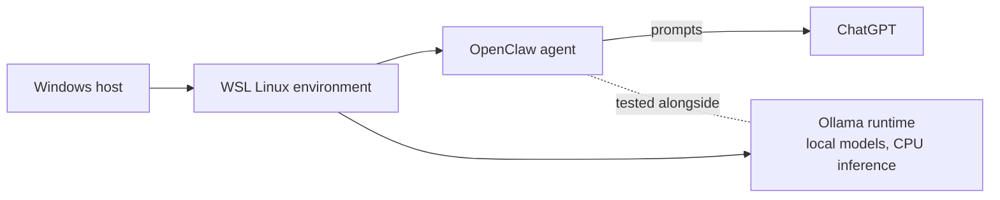

# Local AI Agent Environment: OpenClaw + Ollama on WSL

A personal project (Apr 2026 – May 2026) where I set up and tested the **OpenClaw** AI agent inside **Windows Subsystem for Linux (WSL)**, using **ChatGPT** as the model for OpenClaw and running local large language models with **Ollama** on CPU-only hardware.

## Overview

The goal was to get an AI agent running in WSL, try it alongside locally hosted models, and understand what that costs in CPU, memory, and setup effort on an ordinary desktop without a dedicated GPU.

I installed and configured the stack, worked through setup and authentication problems, benchmarked it, and then made a deliberate decision to tear it down and reclaim resources once I had learned what I needed.

## Stack

| Layer | Tool |
|---|---|
| Environment | Windows Subsystem for Linux (WSL) |
| AI agent | OpenClaw |
| Model used with OpenClaw | ChatGPT |
| Local inference engine | Ollama (local models) |
| Hardware | Intel Core i5, 32 GB RAM, CPU-only (no dedicated GPU) |

## Architecture



Text version:

```
Windows host -> WSL -> OpenClaw (agent) <-> ChatGPT
                   \-> Ollama (local models, CPU inference)
```

## Challenges and fixes

### 1. Installation and scenario failures

**Problem:** I ran into setup friction, authentication errors, and failing scenario packs while running OpenClaw inside WSL.

**What I did:** Troubleshot the installation and configuration inside WSL while testing the agent.

### 2. System resource overhead

**Problem:** Running local models through Ollama alongside the OpenClaw stack put heavy CPU and memory load on the machine. With no GPU, all inference ran on the CPU.

**What I did:** Tested and benchmarked the setup to understand the limits of CPU-only inference on this hardware.

### 3. Clean teardown

After testing, I chose to reclaim system resources with a complete teardown:

- Uninstalled OpenClaw.
- Manually wiped leftover configuration directories.
- Removed cached Ollama model files.

## Lessons learned

- CPU-only hardware quickly becomes the bottleneck when local models (Ollama) and an agent stack run together.
- WSL is convenient for Linux tooling on Windows, but it adds another layer to troubleshoot when installs or authentication fail.
- Cleaning up properly (config folders and cached models, not just the app) matters. Model files take a lot of disk space.

## Next steps

If I revisit local or agent-based AI tools, I would move heavy model inference off the CPU, either to dedicated GPU hardware or to lightweight API endpoints, to avoid the WSL CPU bottleneck.

## Screenshots

_Placeholders. I'll add these later (with any keys, tokens, and usernames removed):_

- [ ] Ollama running a local model in WSL
- [ ] OpenClaw setup / agent run
- [ ] CPU and memory usage during a test run
