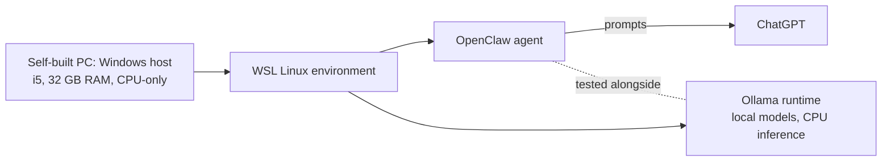

# Local AI Agent Environment: OpenClaw + Ollama on WSL

A personal project (Apr 2026 – May 2026) where I set up and tested the **OpenClaw** AI agent inside **Windows Subsystem for Linux (WSL)**, using **ChatGPT** as the model for OpenClaw and running local large language models with **Ollama**. I ran it on a separate PC that I built myself from parts (Intel Core i5, 32 GB RAM, CPU-only).

## Overview

The goal was to get an AI agent running in WSL, try it alongside locally hosted models, and understand what that costs in CPU, memory, and setup effort on an ordinary desktop without a dedicated GPU.

I installed and configured the stack, worked through setup and authentication problems, benchmarked it, and then made a deliberate decision to tear it down and reclaim resources once I had learned what I needed.

## Stack

| Layer | Tool |
|---|---|
| Environment | Windows Subsystem for Linux (WSL) |
| AI agent | OpenClaw |
| Model used with OpenClaw | ChatGPT |
| Local inference engine | Ollama (local models) |
| Hardware | Self-built test PC: Intel Core i5, 32 GB RAM, CPU-only (no dedicated GPU) |

## Architecture



Text version:

```
Self-built PC (Windows host) -> WSL -> OpenClaw (agent) <-> ChatGPT
                   \-> Ollama (local models, CPU inference)
```

## Challenges and fixes

### 1. Installation and scenario failures

**Problem:** I ran into setup friction, authentication errors, and failing scenario packs while running OpenClaw inside WSL.

**What I did:** Troubleshot the installation and configuration inside WSL while testing the agent.

### 2. System resource overhead

**Problem:** Running local models through Ollama alongside the OpenClaw stack put heavy CPU and memory load on the machine. With no GPU, all inference ran on the CPU.

**What I did:** Tested and benchmarked the setup to understand the limits of CPU-only inference on this hardware.

### 3. Clean teardown

After testing, I chose to reclaim system resources with a complete teardown:

- Uninstalled OpenClaw.
- Manually wiped leftover configuration directories.
- Removed cached Ollama model files.

## Lessons learned

- CPU-only hardware quickly becomes the bottleneck when local models (Ollama) and an agent stack run together.
- WSL is convenient for Linux tooling on Windows, but it adds another layer to troubleshoot when installs or authentication fail.
- Cleaning up properly (config folders and cached models, not just the app) matters. Model files take a lot of disk space.

## Next steps

If I revisit local or agent-based AI tools, I would move heavy model inference off the CPU, either to dedicated GPU hardware or to lightweight API endpoints, to avoid the WSL CPU bottleneck.

## References

I followed and adapted this public tutorial. It installs OpenClaw on a Linux VPS; I adapted the setup to run in WSL on my own PC. The video is credited as a learning resource only.

- [OpenClaw......RIGHT NOW??? (it's not what you think)](https://youtu.be/T-HZHO_PQPY) by NetworkChuck

---

## Setup Guide: Run OpenClaw with Local Models in WSL

A step-by-step version of what I did, so you can try it yourself on a Windows PC. Commands are taken from the official [OpenClaw](https://docs.openclaw.ai), [Ollama](https://github.com/ollama/ollama/blob/main/docs/linux.mdx), and Microsoft WSL docs. OpenClaw changes quickly, so if a step doesn't match what you see, follow the official docs.

> Never paste real API keys, tokens, or passwords into a README, a script you commit, or a screenshot. Placeholders below look like `<your-key>`.

### Prerequisites

- Windows 10/11 with virtualization turned on in the BIOS.
- 16 GB RAM or more (I used 32 GB). No GPU is needed, but local models will be slow on CPU only.
- About 10–20 GB of free disk space for WSL, OpenClaw, and one small model.
- Optional: a ChatGPT/OpenAI account if you want OpenClaw to use OpenAI models instead of (or alongside) local ones.

### Step 1: Install WSL2 with Ubuntu

In **PowerShell (Admin)**:

```powershell
wsl --install -d Ubuntu
```

Restart if asked, open **Ubuntu**, and create your Linux username and password. Then update it:

```bash
sudo apt update && sudo apt upgrade -y
```

OpenClaw's background service and Ollama both use **systemd**. New WSL installs usually have it on. Check:

```bash
systemctl is-system-running
```

If that errors, add this to `/etc/wsl.conf`, then run `wsl --shutdown` in PowerShell and reopen Ubuntu:

```ini
[boot]
systemd=true
```

### Step 2: Node.js

The official OpenClaw installer sets up a supported Node.js for you, so you can skip this step. If you prefer to manage Node yourself, OpenClaw's README currently asks for **Node 24.16.0+ (24.x) or 26.1.0+**. Check with:

```bash
node --version
```

### Step 3: Install OpenClaw

The official one-line installer for macOS / Linux / WSL2:

```bash
curl -fsSL https://openclaw.ai/install.sh | bash
```

On a fresh install, the installer starts the **onboarding wizard** automatically. If you installed with npm instead, start it yourself:

```bash
openclaw onboard --install-daemon
```

Tip: it's good practice to open `https://openclaw.ai/install.sh` and read it before piping it to `bash`.

### Step 4: Install Ollama and pull a small model

```bash
curl -fsSL https://ollama.com/install.sh | sh
ollama pull llama3.2:3b
ollama run llama3.2:3b "Say hello in one sentence."
```

Pick a **small model with tool support** for CPU-only machines. The model above is one example; check the [Ollama library](https://ollama.com/library) for others. Ollama listens on `http://localhost:11434`.

### Step 5: Point OpenClaw at Ollama (and optionally ChatGPT)

1. Run (or re-run) onboarding:

   ```bash
   openclaw onboard
   ```

2. Choose **Ollama**, then **Local only**, and use the base URL `http://localhost:11434`. Use the native URL **without** `/v1`; OpenClaw's docs warn that `/v1` breaks tool calling.
3. **Optional: OpenAI / ChatGPT.** In onboarding you can choose OpenAI and either sign in with your ChatGPT account or use an API key. If you use a key, keep it in an environment variable instead of a file you might commit:

   ```bash
   export OPENAI_API_KEY="<your-key>"
   ```

   To keep it for future sessions, add that line to `~/.bashrc` on your own machine only. Never put it in a repo.
4. Check which models OpenClaw can see:

   ```bash
   openclaw models list --provider ollama
   ```

### Step 6: Test it

```bash
openclaw gateway status
openclaw dashboard
```

`openclaw dashboard` opens the Control UI. Send a short message and confirm you get a reply.

If something fails (login/auth errors, scenarios not working), run the built-in checker:

```bash
openclaw doctor
```

### Step 7: Watch CPU and RAM

In a second Ubuntu window:

```bash
sudo apt install -y htop
htop
```

You can also see which models are loaded with:

```bash
ollama ps
```

In Windows Task Manager, WSL shows up as **VmmemWSL**. To stop WSL from using all your memory, you can create `C:\Users\<you>\.wslconfig` with limits, then run `wsl --shutdown`:

```ini
[wsl2]
memory=16GB
processors=4
```

On CPU-only hardware, expect slow responses and high CPU while a model is answering. That's what pushed me to tear the setup down and plan for a GPU or a hosted API later.

### Step 8: Tear it down and uninstall

**OpenClaw** (from the [official uninstall guide](https://docs.openclaw.ai/install/uninstall)):

```bash
openclaw doctor --fix                # cleans up leftover updater files first
openclaw uninstall --dry-run --all   # preview what will be removed
openclaw uninstall --all             # remove service, state, workspace, and app
```

**Ollama** (from the [official Linux docs](https://github.com/ollama/ollama/blob/main/docs/linux.mdx)):

```bash
ollama rm llama3.2:3b
sudo systemctl stop ollama
sudo systemctl disable ollama
sudo rm /etc/systemd/system/ollama.service
sudo rm -r $(which ollama | tr 'bin' 'lib')
sudo rm $(which ollama)
sudo userdel ollama
sudo groupdel ollama
sudo rm -r /usr/share/ollama
```

**Optional: remove the whole Ubuntu WSL distro.** In PowerShell, `wsl --unregister Ubuntu`. **This permanently deletes everything inside that Linux install**, so copy out anything you want to keep first.

### Troubleshooting

- **`systemctl` errors in WSL:** enable systemd (Step 1) and restart WSL with `wsl --shutdown`.
- **OpenClaw can't find your Ollama model:** make sure Ollama is running (`ollama ps`), the base URL is `http://localhost:11434` without `/v1`, and the model supports tools. See the [OpenClaw Ollama docs](https://docs.openclaw.ai/providers/ollama).
- **Very slow replies:** use a smaller model, close other apps, or offload to a GPU or a hosted API.
- **Anything else:** run `openclaw doctor`, and check the [OpenClaw docs](https://docs.openclaw.ai) and [FAQ](https://docs.openclaw.ai/help/faq).
